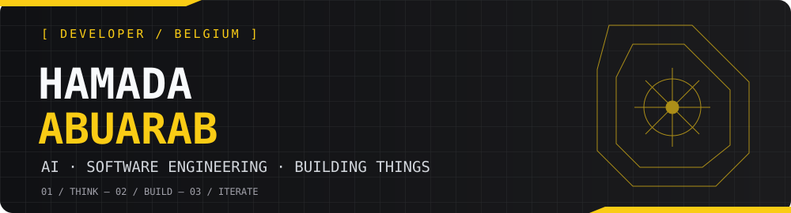

## `01` — About me

I'm a software developer based in Belgium, interested in artificial intelligence, computer vision and full-stack engineering. I enjoy turning complex problems into practical, intuitive software.

- **Building:** AI-powered tools and interactive applications.
- **Exploring:** computer vision, machine learning and human–computer interaction.
- **Approach:** learn by building, testing and improving.

## `02` — Technology stack

**Languages**

**Frameworks & tools**

## `03` — Selected projects

| Project | What it's about |
| :--- | :--- |
| **[GestureDesk ↗](https://github.com/HamadaAB/GestureDesk)** | Exploring gesture-based human–computer interaction. Project in development. |
| **[TrafficSimulation2025 ↗](https://github.com/HamadaAB/TrafficSimulation2025)** | Collaborative University of Antwerp software engineering project simulating vehicles, traffic lights and road networks. |
| **Expertise Finder** | Tectonic Hackathon 2026 · SD Worx challenge. Team prototype for finding colleagues with relevant expertise using evidence from organizational knowledge. |
| **Speako** | AI presentation coach concept combining speech analysis and computer vision to provide feedback on public speaking. |

## `04` — GitHub activity

---

**THINK. BUILD. ITERATE.**

Always learning. Always building.

